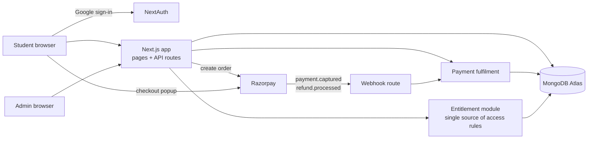

# SparkTribe - engineering case study

[](https://sparktribe.in)


[SparkTribe](https://sparktribe.in) is a placement-preparation platform for Tamil-speaking engineering
students: a 50-day DSA course taught in Tamil, daily practice with spaced revision, DSA and FAANG
preparation trackers, and paid plans. I founded it, and I designed, built and operate the platform
myself, alongside creating the course content.

The source code is private because it contains paid course material and production configuration.
This repository explains how the system works and the engineering decisions behind it. It contains
no proprietary code, credentials or customer data.

## At a glance

| | |
| --- | --- |
| Role | Founder and sole engineer: product, architecture, implementation, deployment, operations |
| Stack | Next.js 14 (App Router), TypeScript, MongoDB Atlas via Mongoose, NextAuth (Google OAuth), Razorpay, Tailwind CSS |
| Hosting | Vercel, Mumbai region (`bom1`) |
| Codebase | 51 API route handlers, 29 Mongoose models, 25 admin pages |
| Tests | 20 test files on Node's built-in test runner; 271 tests pass without a database, plus 10 suites that run against a real throwaway `mongod` |
| Users | 1,200+ registered learners and 200+ paid members (October 2026) |

## Architecture



Main areas of the system:

- **Learning** — course and lesson delivery, progress tracking, completion certificates, articles.
- **Practice** — question banks by category, timed mock tests, and a revision queue scheduled on Indian
  calendar days, since every student is in India.
- **Commerce** — plans, checkout, coupons, referrals and an in-app coin balance (SparkCoins).
- **Admin** — content management with draft revisions and bulk import (preview, then apply), plans and
  pricing, coupons, payments, referrals, support tickets, announcements and an audit log. Every admin API
  route checks the caller's permission scopes on the server.

## Key engineering decisions

### 1. Payments that are safe to process twice

Razorpay confirms a payment through two independent paths: the browser calls a verify endpoint after
checkout, and Razorpay sends a webhook. Either can arrive first, both can arrive at once, and webhooks
are redelivered on failure. A naive "mark paid, then grant access" handler can double-grant or lose a
grant if the function dies between the two writes.

The fulfilment routine is used by both paths and is idempotent by construction:

1. **Money:** one atomic conditional update moves the purchase from `pending` to `completed` and marks
   its entitlement as pending. Only the caller whose update matches does this step; the other reads the
   result.
2. **Access:** the user's plan is updated with a single-document conditional write that only matches if
   the plan fields are still the values the new plan was computed from, and that records the purchase id
   in the same write. Two concurrent payments therefore stack instead of overwriting each other, and the
   same purchase can never be applied twice.

If step 2 fails, the endpoint returns an error, Razorpay redelivers, and the still-pending purchase is
repaired. I chose single-document conditional writes over multi-document transactions because they work
on any MongoDB deployment and can be exercised against a plain local `mongod` in tests. Signatures are
checked with a constant-time HMAC comparison, the captured amount is compared with the order, and a
unique index stops one payment id from being attached to two purchases.

In outline:

```text
claim = purchases.updateOne({ _id, status: "pending" }, { status: "completed", entitlement: "pending" })
loop (bounded retries):
    user = users.find(purchase.userId)
    next = applyPlan(user.plan, purchase)              # pure function, unit-tested
    users.updateOne({ _id, plan: user.plan, appliedPurchases: { $ne: purchaseId } },
                    { plan: next, $push: { appliedPurchases: purchaseId } })
purchases.updateOne({ _id }, { entitlement: "applied" })
```

### 2. One module decides access

Every paid API (courses, progress, certificates) and every payment path asks one entitlement module what
a user has paid for. Tiers are fixed access levels defined in code; plans (names, prices, billing cycles)
are admin-editable data that each grant one level. Paying again stacks time from the later of the current
expiry and the payment date; upgrades convert remaining time; buying a lower tier during a higher one is
refused.

Before enforcing expiry and tiers, I ran a read-only aggregate audit of production data and confirmed the
change would remove access from no existing user. Purchases made before a May 2026 pricing change are
grandfathered under the rules they were sold with.

### 3. Rewards that cannot be double-credited

Referral rewards and task rewards credit SparkCoins with an idempotency key. The balance increment and the
key are written in one single-document update, so repeating or racing the same event credits once, and a
ledger entry is upserted by the same key for auditability.

### 4. Guard rails around environments

Checkout refuses to run (HTTP 503) when a Vercel Preview deployment is configured with live Razorpay keys,
or when Production is configured with test keys. Both mistakes are otherwise silent: the first takes real
money from a test site, the second makes every real checkout fail.

## Testing

- Pure logic (pricing, entitlement, revision scheduling, content parsing, SEO rules) is tested directly.
- Payment fulfilment, refunds, coupons, referrals and coin balances run against a real, throwaway local
  `mongod` started by the test helper, because atomic updates, unique indexes and concurrent requests
  cannot be meaningfully tested with mocks. Those suites skip when no `mongod` binary is available.
- HTTP-level scripts exercise billing, entitlement, learning and practice flows against a running server.

## What I would improve next

- **Rate limiting** is in-memory per serverless instance, so it resets on cold starts. It should move to
  a shared store, as my [personal publishing platform, SparkTime](https://github.com/Karthiikeyan/SparkTime)
  already does with an atomic Postgres upsert.
- **Content Security Policy** still allows `unsafe-inline` and `unsafe-eval` for scripts; moving to
  nonces would tighten it.
- **Refunds** are recorded but do not revoke access automatically; that is a deliberate business choice
  today, but it should become an explicit admin action.
- **Test runner portability:** the database suites need a local `mongod`; running them in CI with a
  MongoDB service container would make every push exercise the payment paths.

## Screenshots


